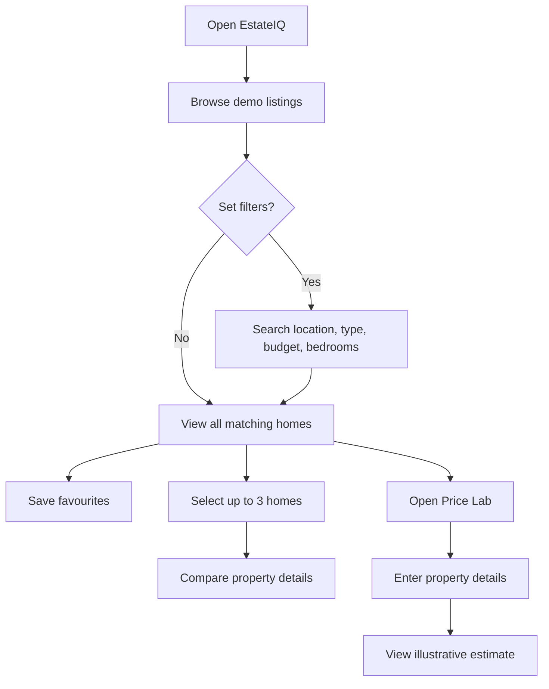
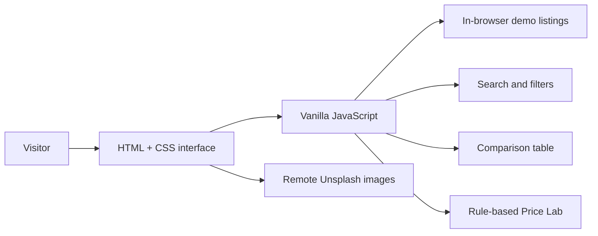
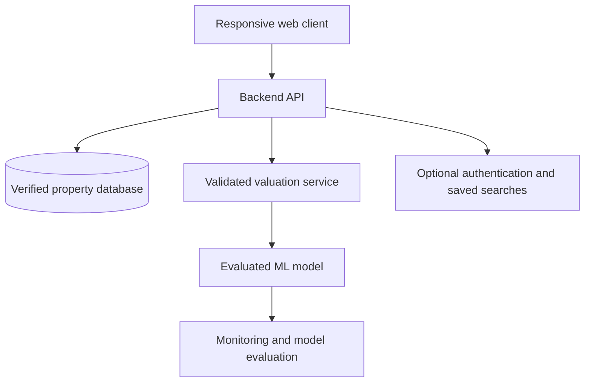

<!-- EstateIQ README — professional project documentation -->

<div align="center">


<br/>

**A responsive real-estate discovery and property comparison experience.**

[**Open Live Demo ↗**](https://kushagra69yr.github.io/EstateIQ/) ·
[Source Code](https://github.com/kushagra69yr/EstateIQ) ·
[Report an Issue](https://github.com/kushagra69yr/EstateIQ/issues)

<br/>


</div>

---

## Table of contents

- [Overview](#-overview)
- [Product preview](#-product-preview)
- [Features](#-features)
- [How it works](#-how-it-works)
- [Price Lab: calculation explained](#-price-lab-calculation-explained)
- [Technology and architecture](#-technology-and-architecture)
- [Project structure](#-project-structure)
- [Run locally](#-run-locally)
- [Deploy with GitHub Pages](#-deploy-with-github-pages)
- [Testing checklist](#-testing-checklist)
- [Limitations and responsible use](#-limitations-and-responsible-use)
- [Roadmap](#-roadmap)
- [Author](#-author)

## 🏡 Overview

**EstateIQ** is a front-end portfolio project that explores a simpler way to browse and compare residential properties. It brings property discovery, shortlisting, side-by-side comparison, and an illustrative price-estimation experience into one responsive interface.

The design uses a warm cream background, deep forest-green accents, large property photography, and clear cards to create a calm, premium real-estate experience.

> **Project status:** This repository currently contains a working-style static UI demo. Property listings are sample data and the Price Lab is a rule-based illustration. It is not connected to a live property marketplace, a database, or a trained machine-learning service.

## ✨ Product preview

<div align="center">
  <a href="https://kushagra69yr.github.io/EstateIQ/">
    
  </a>
  <sub>Residential photography for the product concept. This is not a screenshot or a verified EstateIQ listing.</sub>
</div>

### The intended user journey

1. **Discover** — browse the sample homes and search by city or neighbourhood.
2. **Narrow down** — filter by property type, budget, and minimum bedroom count.
3. **Shortlist** — save favourites while the page is open.
4. **Compare** — select up to three homes to compare their displayed attributes.
5. **Explore price signals** — enter property details in Price Lab to see an illustrative estimate and range.

## 🚀 Features

| Feature | What it does | Current behaviour |
|---|---|---|
| Property cards | Shows name, location, asking price, area, bedrooms, and bathrooms | Uses six hard-coded demo properties |
| Location search | Searches the property name, city, and location text | Browser-side text filtering |
| Type filter | Filters Apartment, Villa, or House | Browser-side filtering |
| Budget filter | Sets a maximum asking price | Uses demo prices in lakhs |
| Bedroom filters | Shows homes with 2+, 3+, or 4+ bedrooms | Applied together with search filters |
| Favourites | Toggles a heart icon for a property | In-memory only; resets on refresh |
| Compare | Selects up to three properties | Opens a comparison view in a new browser window |
| Price Lab | Calculates an indicative estimate and a ±10% range | Rule-based demonstration formula, not ML |
| Responsive layout | Adapts navigation, cards, forms, and sections for smaller screens | CSS media queries |

## 🧭 How it works

### Property discovery flow



### Main components

- **User interface:** HTML defines the page sections and forms; CSS provides the responsive visual design; JavaScript updates the listing cards and interactions.
- **Demo listing data:** A JavaScript array stores the sample property names, locations, types, prices, images, areas, bedrooms, and bathrooms.
- **Filtering:** The current search and filter selections are matched against the sample data in the browser.
- **Comparison:** Selected property IDs are used to create a comparison table containing the attributes available in the demo.
- **Price Lab:** Form inputs are validated and passed to a transparent arithmetic formula. No external API or model inference is called.

## 📈 Price Lab: calculation explained

The estimator is intentionally simple so the demo's behaviour can be inspected and explained. It uses a base rate per square foot for the selected city, a property-type multiplier, small adjustments for additional bedrooms and bathrooms, and an age adjustment.

### Illustrative base rates in the current code

| City | Base rate used by demo |
|---|---:|
| Bengaluru | ₹6,500 / sq ft |
| Hyderabad | ₹5,700 / sq ft |
| Pune | ₹6,200 / sq ft |
| Chennai | ₹6,000 / sq ft |
| Mumbai | ₹12,500 / sq ft |

These are **example constants in the code, not current market data or recommended valuation rates**.

### Formula

Let:
- (A) = built-up area in square feet
- (R_c) = illustrative base rate for the selected city
- (M_t) = property-type multiplier
- (B) = number of bedrooms
- (W) = number of bathrooms
- (Y) = property age in years

```text
type multiplier:
  Apartment = 1.00
  House     = 1.08
  Villa     = 1.22

feature multiplier =
  1 + max(0, B - 2) × 0.025 + max(0, W - 2) × 0.012

age multiplier =
  max(0.72, 1 - Y × 0.004)

estimated price =
  A × R_c × M_t × feature multiplier × age multiplier

displayed range =
  estimated price × 0.90  to  estimated price × 1.10
```

The range is a fixed ±10% presentation around the formula output. It is **not** a statistically calculated confidence interval. The current formula does not account for exact locality, land title, building condition, amenities, floor, market movement, comparable sales, or other factors that affect real property values.

## 🧱 Technology and architecture

<div align="center">
  
</div>

| Technology | Role in this project |
|---|---|
| HTML5 | Semantic sections, listing cards, forms, and page structure |
| CSS3 | Layout, typography, responsive breakpoints, colours, and interaction states |
| Vanilla JavaScript | Filtering, favourites, comparison, form validation, and price calculation |
| GitHub | Version control and source hosting |
| GitHub Actions + GitHub Pages | Static-site deployment workflow |

### Current architecture



There is no server-side API, database, authentication, or trained model in the current version. A future production architecture is outlined in the roadmap below.

## 📂 Project structure

```text
EstateIQ/
├── .github/
│   └── workflows/
│       └── pages.yml       # GitHub Pages deployment workflow
├── assets/
│   └── estateiq-banner.svg # Custom README banner artwork
├── .nojekyll               # Avoid Jekyll processing for static files
├── index.html              # App markup, styles, sample data, and UI logic
├── LICENSE                 # MIT License
└── README.md               # Project documentation
```

The current app is deliberately kept in one HTML file so it can be hosted without a build step.

## 💻 Run locally

### Option 1 — Open directly

1. Clone or download this repository.
2. Open the project folder.
3. Open `index.html` in a modern browser.

An internet connection is needed for the remote property photography.

### Option 2 — Use a local development server

If Python is installed, run this command from the repository directory:

```bash
python -m http.server 8000
```

Then open [http://localhost:8000](http://localhost:8000).

No package installation or build command is required for the current static demo.

## 🌐 Deploy with GitHub Pages

A GitHub Actions workflow is included at `.github/workflows/pages.yml`. It publishes the repository root when a commit is pushed to `main` or the workflow is manually started.

1. Open **Settings → Pages** in this repository.
2. If prompted, configure Pages to use **GitHub Actions** as the build and deployment source.
3. Open the **Actions** tab and inspect **Deploy EstateIQ to GitHub Pages**.
4. When the workflow succeeds, open the deployment URL shown in the workflow or the Pages settings.

Expected project URL:

**https://kushagra69yr.github.io/EstateIQ/**

The URL becomes available after GitHub Pages is configured and the first deployment completes.

## ✅ Testing checklist

Use this checklist when manually reviewing the demo:

- [ ] Search for a city, neighbourhood, or property name.
- [ ] Combine location search with property type and budget.
- [ ] Test each bedroom filter and confirm the result count changes.
- [ ] Toggle a property's favourite state and refresh to observe the in-memory behaviour.
- [ ] Select one, two, and three properties for comparison.
- [ ] Confirm a fourth selection is rejected while three are selected.
- [ ] Submit valid Price Lab values for different cities and property types.
- [ ] Try empty, non-numeric, and out-of-range form values.
- [ ] Review the layout on a narrow mobile viewport.
- [ ] Check that remote images load and the browser allows the comparison window to open.

This checklist describes recommended manual checks; it does not claim that an automated test suite currently exists.

## ⚠️ Limitations and responsible use

- **Sample listings:** Names, locations, features, prices, and listing images are demonstration content and are not verified availability.
- **Illustrative price estimates:** The formula is rule-based. It is not a trained machine-learning model, a professional valuation, financial advice, or a guarantee of sale price.
- **Temporary favourites:** Saved state is held in page memory and is lost when the page is refreshed.
- **No backend:** There is no database, account system, live listing feed, API, or persistent user profile.
- **External photography:** Property images are loaded from Unsplash and require an internet connection.
- **Browser behaviour:** The comparison view opens a new tab/window, which may be blocked by strict popup settings.

## 🗺️ Roadmap

The following are potential future improvements, **not features currently implemented**.

### Phase 1 — Strengthen the front end
- Add automated unit tests and accessibility checks.
- Improve image loading states, empty states, and error handling.
- Persist favourites locally with a clear reset option.
- Add property detail pages and better sorting.

### Phase 2 — Add reliable data services
- Create a backend API using FastAPI or a similar framework.
- Store listings in PostgreSQL.
- Integrate a lawful, trusted property-data provider.
- Add input validation, logging, API documentation, and tests.

### Phase 3 — Build a genuine ML valuation workflow
- Collect licensed, representative historical transaction data.
- Define target variables and prevent data leakage.
- Establish a simple baseline model, then evaluate alternatives such as Random Forest or gradient boosting.
- Evaluate with a held-out test set and suitable regression metrics such as MAE and RMSE.
- Track geographic/time-based generalisation, uncertainty, and model limitations.
- Serve predictions through a versioned API only after validation.

### Proposed future architecture



This diagram is a target design only. None of the backend, database, or trained-model components shown here are deployed in this repository today.

## 👨‍💻 Author

**Kushagra Burman**  
B.E. Artificial Intelligence & Machine Learning · BMS Institute of Technology and Management, Bengaluru

- GitHub: [@kushagra69yr](https://github.com/kushagra69yr)
- Portfolio: [kushagra69yr.github.io](https://kushagra69yr.github.io)
- Project: [EstateIQ repository](https://github.com/kushagra69yr/EstateIQ)

## 📄 License

Distributed under the MIT License. See [LICENSE](LICENSE) for details.

---

<div align="center">
  <strong>EstateIQ</strong><br/>
  <sub>Discover thoughtfully. Compare clearly. Understand the estimate.</sub>
</div>
